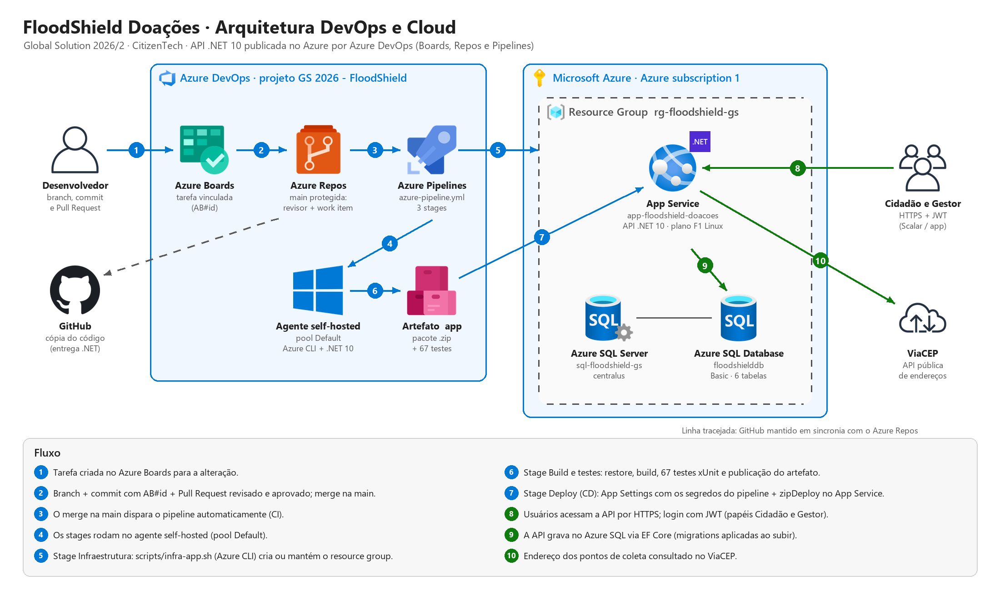

# FloodShield Doações API

API em .NET para organizar doações para abrigos e pontos de coleta durante enchentes.
Faz parte do projeto **FloodShield** (Global Solution 2026/2 - CitizenTech, FIAP).

## O problema

Quando uma cidade alaga, a vontade de ajudar aparece rápido, mas as doações chegam desencontradas:
um abrigo recebe 500 pacotes de roupa e fica sem água, outro do lado não recebe nada.
Quem quer doar não sabe o que está faltando nem onde.

## A solução

Os gestores (Defesa Civil, prefeitura, responsáveis pelos abrigos) cadastram os pontos de coleta
e o que cada um está precisando, com quantidade e urgência. O cidadão vê **onde a doação dele faz
mais falta**, promete o que vai levar e recebe um código de entrega. Quando ele entrega, o gestor
confirma com o código e o saldo da necessidade é atualizado na hora.

ODS relacionados: **9** (indústria, inovação e infraestrutura), **11** (cidades e comunidades sustentáveis)
e **13** (ação contra a mudança do clima).

## Tecnologias

- .NET 10 com ASP.NET Core Minimal API
- Entity Framework Core + SQL Server (Azure SQL na nuvem)
- Autenticação JWT com dois papéis: `Cidadao` e `Gestor`
- OpenAPI + Scalar para a documentação interativa
- Rate limiting e health checks nativos do ASP.NET Core
- ViaCEP para preencher o endereço dos pontos de coleta
- xUnit, Moq e `WebApplicationFactory` nos testes

## Funcionalidades

| Recurso | O que faz |
|---|---|
| Auth | Cadastro (sempre como cidadão), login com JWT, ver/editar/excluir a própria conta |
| Pontos de coleta | CRUD (gestor). O endereço é preenchido pelo CEP. Se o ViaCEP estiver fora, aceita o endereço digitado |
| Itens | CRUD do catálogo (gestor): água, alimento, higiene, roupa, pet... |
| Necessidades | CRUD (gestor). Cada necessidade mostra necessário, entregue, prometido e quanto falta |
| Prioridades | `GET /api/necessidades/prioritarias`: necessidades abertas ordenadas por urgência e pelo que falta |
| Doações | O cidadão promete, edita ou exclui enquanto não entregou. O gestor confirma a entrega com o código ou cancela |

### Regras principais

- Não dá para doar mais do que falta (`422`).
- Quando o entregue completa a quantidade, a necessidade vira `Atendida` sozinha.
- Duas pessoas doando ao mesmo tempo a última unidade: só uma passa (a linha da necessidade fica travada durante a gravação).
- Ponto com necessidades, item em uso, necessidade com doações e conta com doações não podem ser excluídos (`409`).
- O cidadão só enxerga as próprias doações. O gestor enxerga todas.

### Idempotência

O `POST /api/doacoes` exige o header `Idempotency-Key`. Se o app mandar a mesma requisição duas vezes
(toque duplo, internet caindo e reenviando), a segunda volta com a mesma resposta da primeira e o header
`Idempotent-Replayed: true`, sem criar outra doação. A mesma chave com um corpo diferente retorna `409`.

### Rate limiting

| Rota | Limite |
|---|---|
| `/api/auth/*` | 5 por minuto por IP |
| `POST /api/doacoes` | 10 por minuto por usuário |
| Resto da API | 100 por minuto por IP |

Acima do limite a resposta é `429` com o header `Retry-After`. Os limites ficam no `appsettings.json` (seção `RateLimit`).

### Health checks

- `GET /health/live`: a API está no ar.
- `GET /health/ready`: verifica o banco e o ViaCEP. Sem ViaCEP fica `Degraded` (a API continua funcionando); sem banco fica `Unhealthy` (`503`).

## Endpoints

A documentação completa fica em `/scalar` com a API rodando. Resumo:

| Método | Rota | Quem |
|---|---|---|
| POST | `/api/auth/registrar` | público |
| POST | `/api/auth/login` | público |
| GET / PUT / DELETE | `/api/usuarios/me` | logado (DELETE só cidadão) |
| GET | `/api/pontos-coleta`, `/api/pontos-coleta/{id}` | logado |
| POST / PUT / DELETE | `/api/pontos-coleta` | gestor |
| GET | `/api/itens`, `/api/itens/{id}` | logado |
| POST / PUT / DELETE | `/api/itens` | gestor |
| GET | `/api/necessidades`, `/api/necessidades/{id}`, `/api/necessidades/prioritarias` | logado |
| POST / PUT / DELETE | `/api/necessidades` | gestor |
| PATCH | `/api/necessidades/{id}/cancelar` | gestor |
| POST | `/api/doacoes` | cidadão |
| GET | `/api/doacoes`, `/api/doacoes/{id}` | logado |
| PUT / DELETE | `/api/doacoes/{id}` | cidadão (dono) |
| PATCH | `/api/doacoes/{id}/confirmar-entrega`, `/api/doacoes/{id}/cancelar` | gestor |

As listagens aceitam filtros, `ordenarPor`, `direcao=desc`, `pagina` e `tamanhoPagina` (máximo 50).

## Como rodar

Pré-requisitos: .NET 10 SDK e Docker.

1. Suba um SQL Server:

```
docker run -d --name floodshield-sql -e "ACCEPT_EULA=Y" -e "MSSQL_SA_PASSWORD=<sua-senha-forte>" -p 1433:1433 mcr.microsoft.com/mssql/server:2022-latest
```

2. Configure os segredos (ficam fora do repositório):

```
cd src/FloodShield.Doacoes.Api
dotnet user-secrets set "ConnectionStrings:DefaultConnection" "Server=localhost,1433;Database=FloodShieldDoacoes;User Id=sa;Password=<sua-senha-forte>;TrustServerCertificate=True"
dotnet user-secrets set "Jwt:Key" "<chave-com-pelo-menos-32-caracteres>"
dotnet user-secrets set "Gestor:Email" "gestor@floodshield.com"
dotnet user-secrets set "Gestor:Senha" "<senha-do-gestor>"
```

3. Rode a API (as tabelas são criadas pelas migrations quando ela sobe):

```
dotnet run --project src/FloodShield.Doacoes.Api
```

A documentação abre em `http://localhost:5125/scalar`.

### Usuários de teste

- **Gestor:** criado automaticamente na primeira execução com o e-mail e a senha de `Gestor:Email` e `Gestor:Senha`.
- **Cidadão:** é só se cadastrar em `POST /api/auth/registrar`.

Na nuvem os mesmos valores vêm de variáveis de ambiente (`ConnectionStrings__DefaultConnection`, `Jwt__Key`, `Gestor__Email`, `Gestor__Senha`).

## Testes

```
dotnet test
```

- `FloodShield.Doacoes.UnitTests`: regras de saldo, prioridade, status, quantidade e código de entrega, e o health check do ViaCEP com Moq.
- `FloodShield.Doacoes.IntegrationTests`: sobe a API com `WebApplicationFactory`, SQLite em memória e um ViaCEP falso, e testa login, permissões, CRUD, doações, idempotência, health check e rate limiting.

## DevOps e Cloud (Azure)

API publicada em **https://app-floodshield-doacoes.azurewebsites.net** (documentação em `/scalar`).



O código fica no **Azure Repos** do projeto *GS 2026 - FloodShield* no Azure DevOps, com uma cópia neste GitHub.
Toda alteração segue o fluxo: tarefa no **Azure Boards** → branch → commit com `AB#<id>` → **Pull Request** → merge na `main`.

A `main` é protegida por três políticas: pelo menos um revisor (quem abre o PR pode aprovar), work item vinculado obrigatório
e revisor padrão.

### Pipeline (`azure-pipeline.yml`)

O merge na `main` dispara o pipeline, que roda no agente self-hosted do pool `Default`:

| Stage | O que faz |
|---|---|
| Criar infraestrutura | Roda `scripts/infra-app.sh` com o Azure CLI. Cria (ou mantém, se já existir) o resource group, o Azure SQL e o App Service |
| Build e testes | Restore, build, os testes unitários e de integração e a publicação do artefato `app` (zip da API) |
| Deploy no Azure App Service | Grava as configurações no App Service e publica o artefato com zipDeploy |

### Recursos no Azure

| Recurso | Nome | Região |
|---|---|---|
| Resource Group | `rg-floodshield-gs` | centralus |
| Azure SQL Server | `sql-floodshield-gs` | centralus |
| Banco Azure SQL (Basic) | `floodshielddb` | centralus |
| App Service Plan (F1 Linux) | `asp-floodshield-gs` | westus3 |
| App Service (.NET 10) | `app-floodshield-doacoes` | westus3 |

O DDL das tabelas está em `scripts/script-bd.sql` (gerado das migrations do EF Core). Quando a API sobe, ela aplica as migrations sozinha.

### Variáveis do pipeline

Ficam secretas no Azure DevOps (*Pipelines → Edit → Variables*) e nunca no repositório:
`SQL_ADMIN_USER`, `SQL_ADMIN_PASSWORD`, `JWT_KEY`, `GESTOR_EMAIL` e `GESTOR_SENHA`.
O usuário e a senha do banco chegam ao script de infra como variáveis de ambiente, e as demais viram configurações do App Service.

### Exemplos de JSON para o CRUD

Faça login em `POST /api/auth/login` e use o token como `Bearer`. Pontos de coleta, itens e necessidades exigem o gestor.

```json
// POST /api/pontos-coleta  (PUT /api/pontos-coleta/{id} usa o mesmo corpo)
{ "nome": "Ginásio Municipal", "cep": "01310100", "numero": "1578", "horario": "8h às 18h", "ativo": true }

// POST /api/itens  (PUT /api/itens/{id})
{ "nome": "Água mineral", "categoria": "Agua", "unidade": "Litro" }

// POST /api/necessidades
{ "pontoColetaId": 1, "itemId": 1, "quantidadeNecessaria": 200, "urgencia": "Alta" }
// PUT /api/necessidades/{id}
{ "quantidadeNecessaria": 250, "urgencia": "Critica" }

// POST /api/doacoes  (cidadão, header Idempotency-Key obrigatório)
{ "necessidadeId": 1, "quantidade": 30 }
// PUT /api/doacoes/{id}
{ "quantidade": 40 }
// PATCH /api/doacoes/{id}/confirmar-entrega  (gestor)
{ "codigo": "XGQRC8" }

// POST /api/auth/registrar  |  PUT /api/usuarios/me
{ "nome": "Maria Souza", "email": "maria@email.com", "senha": "senha123" }
{ "nome": "Maria S. Souza" }
```

Os DELETE usam só o id na rota (`DELETE /api/itens/{id}`, `DELETE /api/doacoes/{id}` etc.). A conta é excluída com `DELETE /api/usuarios/me`.

## Uso de IA

Usamos o Claude (Anthropic), pelo Claude Code, como apoio no desenvolvimento:

- explicar erros e tirar dúvidas de .NET, Entity Framework, Azure e Azure DevOps;
- apoiar a configuração do pipeline e da infraestrutura no Azure;
- revisar o README e o desenho da arquitetura.

Todo o conteúdo foi revisado, testado e entendido por nós antes de entrar no repositório.

## Integrantes

- Bruno Vinicius Barbosa - RM 566366
- Guilherme de Andrade Martini - RM 566087
- Nathan Gonçalves Pereira Mendes - RM 564666
- Raphael Gomes Mancera - RM 562279
